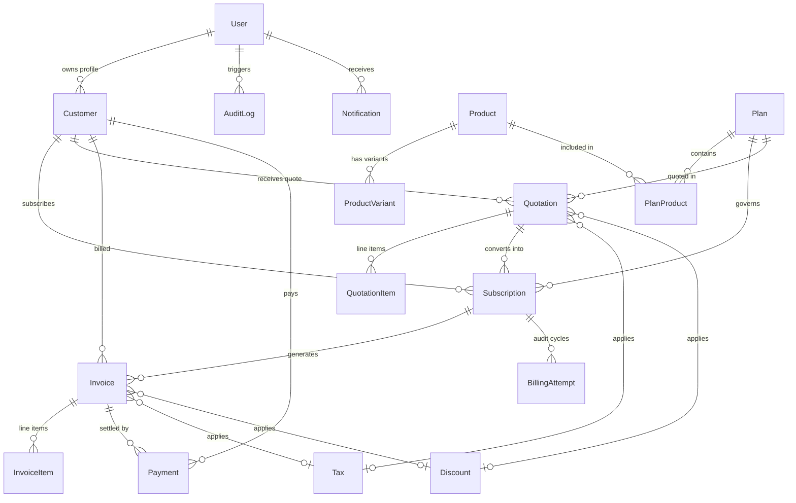

# Brightloop Subscription Management System - Database Design

## 1. Architecture & Storage Engine
- **Engine:** PostgreSQL 16+ (tested on PostgreSQL 18)
- **ORM:** Prisma 5.22+
- **Integrity:** Foreign keys with referential actions (`CASCADE`, `RESTRICT`, `SET NULL`), unique constraints, and optimized composite indexes for high-throughput billing and customer lookup.

---

## 2. Entity-Relationship Model (Mermaid Diagram)

---

## 3. Detailed Table Specifications

### 3.1. `User`
Stores system accounts for role-based authentication.
- `id` (UUID, PK)
- `email` (VARCHAR(255), UNIQUE, NOT NULL)
- `password` (VARCHAR(255), hashed via bcrypt salt 10)
- `name` (VARCHAR(150), NOT NULL)
- `role` (ENUM: `ADMIN`, `STAFF`, `CUSTOMER`, DEFAULT: `CUSTOMER`)
- `isActive` (BOOLEAN, DEFAULT: true)
- `phone` (VARCHAR(50), NULL)
- `companyName` (VARCHAR(150), NULL)
- `address` (TEXT, NULL)
- `resetToken` (VARCHAR(255), NULL)
- `resetTokenExpiry` (TIMESTAMP, NULL)
- `createdAt`, `updatedAt`

### 3.2. `Customer`
Dedicated client records for corporate entities and billing contacts.
- `id` (UUID, PK)
- `userId` (UUID, FK -> User.id, UNIQUE, NULL)
- `name` (VARCHAR(150), NOT NULL)
- `email` (VARCHAR(255), UNIQUE, NOT NULL)
- `phone` (VARCHAR(50), NULL)
- `companyName` (VARCHAR(150), NULL)
- `taxNumber` (VARCHAR(100), NULL)
- `address`, `city`, `state`, `country`, `postalCode` (VARCHAR/TEXT)
- `status` (ENUM: `ACTIVE`, `INACTIVE`, DEFAULT: `ACTIVE`)
- `notes` (TEXT, NULL)
- `createdAt`, `updatedAt`

### 3.3. `Product` & `ProductVariant`
Catalog of SaaS applications, microservices, and add-on capacity.
- `Product`: `id`, `name`, `code` (UNIQUE), `description`, `category`, `type` (ENUM: `RECURRING`, `ONE_TIME`), `unitPrice`, `isActive`, `createdAt`, `updatedAt`
- `ProductVariant`: `id`, `productId` (FK -> Product.id), `name`, `value`, `sku` (UNIQUE), `priceExtra`, `isActive`, `createdAt`, `updatedAt`

### 3.4. `Plan` & `PlanProduct`
Recurring subscription tiers.
- `Plan`: `id`, `name`, `code` (UNIQUE), `description`, `price`, `interval` (ENUM: `DAILY`, `WEEKLY`, `MONTHLY`, `QUARTERLY`, `HALF_YEARLY`, `YEARLY`), `intervalCount` (INT, DEFAULT: 1), `trialPeriodDays` (INT, DEFAULT: 0), `isActive` (BOOLEAN, DEFAULT: true)
- `PlanProduct`: `id`, `planId` (FK), `productId` (FK), `quantity` (INT, DEFAULT: 1)

### 3.5. `Tax` & `Discount`
Financial rates and promotional deductions.
- `Tax`: `id`, `name`, `code` (UNIQUE), `rate` (DECIMAL(5,2), e.g. 18.00%), `isCompound`, `isActive`
- `Discount`: `id`, `code` (UNIQUE), `type` (ENUM: `PERCENTAGE`, `FIXED_AMOUNT`), `value` (DECIMAL(10,2)), `minPurchaseAmount`, `maxDiscountAmount`, `startDate`, `endDate`, `usageLimit`, `usedCount`, `isActive`

### 3.6. `Quotation` & `QuotationItem`
Formal business proposals and pricing agreements.
- `Quotation`: `id`, `quotationNumber` (UNIQUE), `customerId` (FK), `planId` (FK, NULL), `status` (ENUM: `DRAFT`, `SENT`, `ACCEPTED`, `REJECTED`, `EXPIRED`, `CONVERTED`), `subtotal`, `taxAmount`, `discountAmount`, `totalAmount`, `taxId` (FK, NULL), `discountId` (FK, NULL), `validUntil`, `terms`, `notes`, `convertedAt`
- `QuotationItem`: `id`, `quotationId` (FK), `productId` (FK), `variantId` (FK, NULL), `description`, `quantity`, `unitPrice`, `taxRate`, `discountAmount`, `total`

### 3.7. `Subscription`
Core recurring relationship binding customer to a plan.
- `id` (UUID, PK)
- `subscriptionNumber` (UNIQUE)
- `customerId` (FK -> Customer.id)
- `planId` (FK -> Plan.id)
- `quotationId` (FK -> Quotation.id, NULL)
- `status` (ENUM: `TRIAL`, `ACTIVE`, `PAUSED`, `CANCELLED`, `EXPIRED`)
- `startDate` (TIMESTAMP)
- `currentPeriodStart` (TIMESTAMP)
- `currentPeriodEnd` (TIMESTAMP)
- `nextBillingDate` (TIMESTAMP)
- `trialEndsAt` (TIMESTAMP, NULL)
- `cancelledAt` (TIMESTAMP, NULL)
- `pauseReason` / `cancellationReason` (TEXT, NULL)
- `autoRenew` (BOOLEAN, DEFAULT: true)

### 3.8. `BillingAttempt`
Audit trail safeguarding recurring billing idempotency.
- `id` (UUID, PK)
- `subscriptionId` (FK -> Subscription.id)
- `invoiceId` (FK -> Invoice.id, NULL)
- `periodStart` (TIMESTAMP)
- `periodEnd` (TIMESTAMP)
- `status` (ENUM: `SUCCESS`, `FAILED`)
- `errorMessage` (TEXT, NULL)
- `attemptDate` (TIMESTAMP)
- **Unique Constraint:** `[subscriptionId, periodStart, periodEnd]` ensures duplicate cycles are rejected by DB.

### 3.9. `Invoice` & `InvoiceItem`
Financial receivables and ledger entries.
- `Invoice`: `id`, `invoiceNumber` (UNIQUE), `customerId` (FK), `subscriptionId` (FK, NULL), `quotationId` (FK, NULL), `status` (ENUM: `DRAFT`, `ISSUED`, `PAID`, `PARTIALLY_PAID`, `OVERDUE`, `CANCELLED`, `REFUNDED`), `issueDate`, `dueDate`, `subtotal`, `taxAmount`, `discountAmount`, `totalAmount`, `amountPaid`, `amountDue`, `taxId`, `discountId`, `notes`, `paymentTerms`
- `InvoiceItem`: `id`, `invoiceId` (FK), `productId` (FK, NULL), `variantId` (FK, NULL), `description`, `quantity`, `unitPrice`, `taxRate`, `discountAmount`, `total`

### 3.10. `Payment`
Tracks funds received and reconciled.
- `id` (UUID, PK)
- `paymentNumber` (UNIQUE)
- `invoiceId` (FK -> Invoice.id)
- `customerId` (FK -> Customer.id)
- `amount` (DECIMAL(12,2))
- `paymentMethod` (ENUM: `CASH`, `BANK_TRANSFER`, `CREDIT_CARD`, `UPI`, `OTHER`)
- `status` (ENUM: `PENDING`, `SUCCESS`, `FAILED`, `REFUNDED`)
- `referenceNumber` (VARCHAR(150), NULL)
- `paymentDate` (TIMESTAMP)
- `notes` (TEXT, NULL)

### 3.11. `AuditLog`, `Notification`, `SystemSettings`
- `AuditLog`: `id`, `userId` (FK, NULL), `action`, `entityType`, `entityId`, `details` (JSON), `ipAddress`, `createdAt`
- `Notification`: `id`, `userId` (FK), `title`, `message`, `type` (`INFO`, `WARNING`, `SUCCESS`, `DANGER`), `isRead`, `link`, `createdAt`
- `SystemSettings`: Singleton storing company name, invoicing prefixes, currency, and tax IDs.

